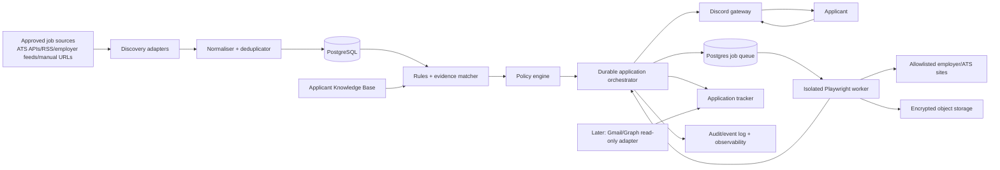
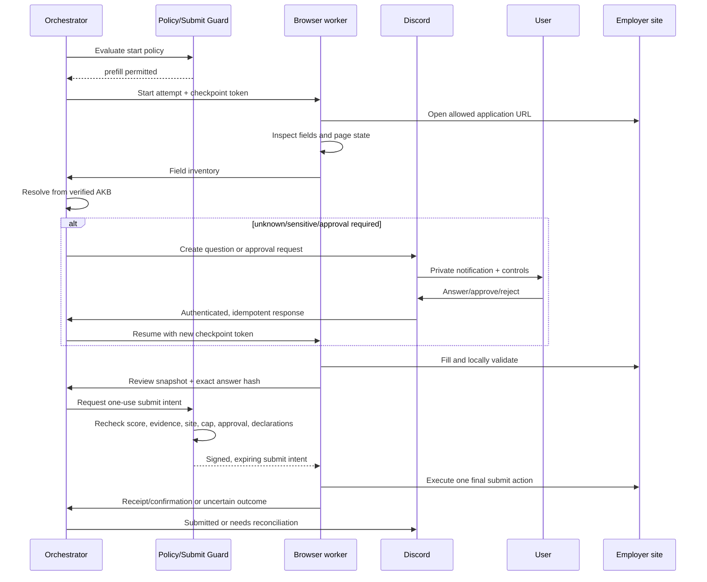
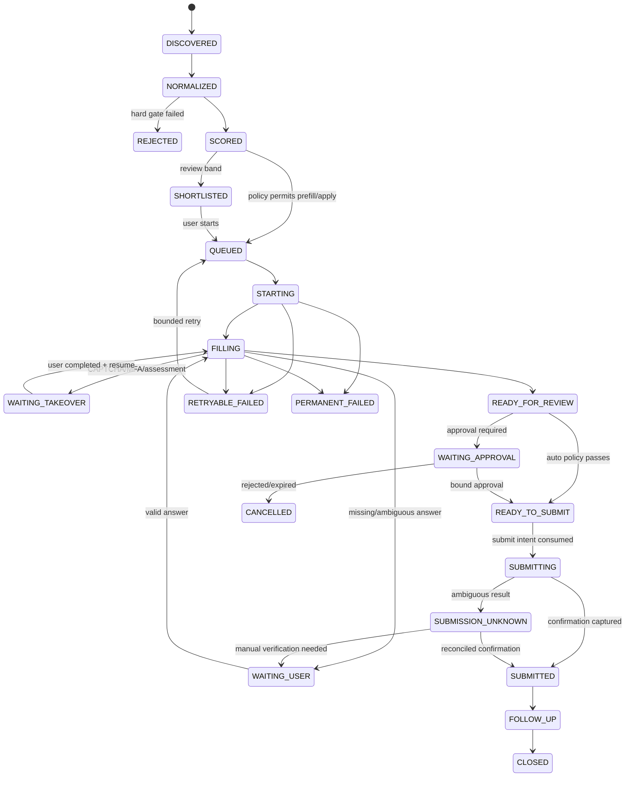

# Standalone AI Job-Application Agent

**Status:** Architecture baseline for implementation  
**Version:** 1.0  
**Scope:** New standalone project; no MapVantage code, data, accounts, deployment, database, secrets, or infrastructure  
**Initial user:** One UK-based applicant  
**Implementation gate:** No browser automation work begins until this specification and the initial site-policy allowlist are approved.

## 1. Product contract

The system discovers suitable jobs, extracts their requirements, compares them with verified applicant facts, and manages each application through a durable workflow. It may pre-fill an application and may auto-submit only when every configured policy gate passes. If an answer, approval, CAPTCHA, MFA step, or user judgement is required, it pauses, asks through Discord, persists the checkpoint, and resumes from that checkpoint.

It must never invent a qualification, job, date, achievement, salary, right-to-work status, security clearance, licence, protected-characteristic answer, or any other applicant fact.

### Initial policy defaults

| Policy | Default |
|---|---|
| Minimum salary | GBP 25,000 gross annual equivalent |
| Auto-application cap | 30 per Europe/London calendar day |
| High-match auto-submit threshold | 85/100, subject to every other gate |
| Approval band | 70–84: pre-fill, then wait for approval |
| Review band | 50–69: shortlist only; do not open an application automatically |
| Low match | Below 50: reject/archive with reasons |
| Unknown mandatory prerequisite | Blocks auto-submit and requires review |
| Unknown or ambiguous salary | Blocks auto-submit; may be shortlisted or pre-filled |
| CAPTCHA, MFA, assessment, e-signature, declaration, voluntary diversity question | Always pause for the user |
| New or unreviewed destination domain | Never auto-submit |
| Default submit mode | `approval_required`; auto-submit is enabled later only per allowlisted adapter/domain |

Thresholds are configuration, not source-code constants. The policy decision and configuration version used for every application are recorded.

### Non-goals for the MVP

- Circumventing CAPTCHAs, bot controls, rate limits, or platform restrictions.
- Automating LinkedIn Easy Apply, Indeed Apply, or another site whose terms prohibit it, unless an official integration or written permission explicitly permits the use case.
- Taking online tests, video interviews, identity checks, or assessments for the applicant.
- Generating unsupported claims or “optimising” facts beyond their verified meaning.
- Sending application-related email or responding to recruiters in the MVP. Email is a later, read-only-first integration.
- A multi-user SaaS product. The data model remains user-scoped so this can be added later.

## 2. Architecture decisions

### Recommended implementation stack

- **Language/runtime:** TypeScript on a supported Node.js LTS release.
- **Repository:** pnpm monorepo with strict TypeScript, ESLint, Prettier, Vitest, and Playwright tests.
- **Control-plane HTTP API:** Fastify with JSON Schema/OpenAPI validation.
- **Database:** PostgreSQL 16+ as the system of record.
- **Durable jobs:** a PostgreSQL-backed queue such as `pg-boss`; avoid Redis in the MVP.
- **Browser:** Playwright Chromium in an isolated worker process/container.
- **Discord:** Discord interactions and slash commands, implemented with `discord.js` or direct REST/webhook handlers.
- **Files:** S3-compatible object storage in hosted deployments; encrypted local filesystem in local-only development.
- **LLM:** provider adapter with schema-constrained responses. The model proposes structured facts/actions; deterministic code validates and authorises them.
- **Observability:** OpenTelemetry-compatible traces/metrics plus structured JSON logs with central redaction.
- **Deployment:** Docker Compose locally; later split the control plane and browser worker into separate services.

This is intentionally a **modular monolith plus a separate browser worker**, not microservices. PostgreSQL, an outbox, and a durable state machine provide enough reliability for one user without the cost and operational burden of Kafka, Kubernetes, Redis, or a workflow platform.

### Trust boundaries

1. **Trusted control plane:** policies, state transitions, verified applicant data, approval records, and submit guard.
2. **Semi-trusted model output:** structured extraction, classification, proposed field mappings, and draft prose. It is never authority to submit.
3. **Untrusted external content:** job adverts, employer pages, form labels, email, attachments, and page scripts. They are data, never instructions.
4. **Sensitive execution boundary:** browser sessions, cookies, files, passwords, and tokens live in the browser worker/secrets layer and are not placed in model prompts.
5. **Human authority:** only the allowlisted Discord user (or later secure web portal session) can approve, answer, take over, or change policies.

## 3. System architecture



### Component responsibilities

| Component | Owns | Must not do |
|---|---|---|
| Discovery adapters | Fetch jobs from approved APIs, feeds, employer sites, or manual URLs; maintain cursors | Apply, follow arbitrary links, or bypass source terms |
| Normaliser/deduplicator | Canonical job shape, company/domain identity, salary/location normalisation, content hash | Decide applicant fit |
| Requirement extractor | Convert advert text to typed requirements with quoted evidence and confidence | Treat preferred criteria as mandatory without evidence |
| Applicant Knowledge Base (AKB) | Versioned verified facts, documents, answer templates, consent/sensitivity metadata | Store secrets or fabricate missing data |
| Matcher | Hard gates, evidence links, transparent score, uncertainty | Make the final submit decision |
| Policy engine | Site permission, salary, cap, score, confidence, data sensitivity, approval, and declaration gates | Browse or generate facts |
| Orchestrator | State machine, timers, pauses, retries, checkpoints, resumptions | Directly click a submit control |
| Answer resolver | Resolve fields only from AKB/evidence; draft answers from approved facts | Infer unsupported facts from absence or job text |
| Browser worker | Inspect, fill, validate, capture evidence, and execute an authorised submit intent | Decide policy, bypass CAPTCHA, or retry an uncertain submit |
| Submit Guard | Re-evaluate all gates immediately before the final click; issue one-use submit token | Generate answers or alter form data |
| Discord gateway | Notifications, commands, buttons/modals, identity checking, secure-link handoff | Put high-risk PII or secrets in Discord messages |
| Tracker | Application timeline, status, receipts, follow-up dates, funnel reporting | Treat an unconfirmed click as a successful submission |
| Email adapter (later) | Read minimal job-related email metadata/content and correlate to applications | Send/reply, bulk-read unrelated mail, or mutate mail in first release |

## 4. End-to-end data flows

### 4.1 Discovery and matching

1. Scheduler emits `discovery.run.requested(source_id, cursor)`.
2. An approved source adapter fetches new records within source-specific limits.
3. Raw source data is saved with a content hash and short retention window; executable content is never run.
4. Normalisation creates/updates a canonical job using `(source, external_id)` and a secondary fingerprint of canonical URL, employer, title, and location.
5. Requirement extraction emits typed requirements. Every extracted requirement keeps a source excerpt/location and confidence.
6. Hard gates run before any LLM similarity scoring. A definite mandatory mismatch rejects the job.
7. The matcher links each requirement to AKB evidence and produces a score, evidence coverage, uncertainty, and human-readable reason list.
8. The policy engine chooses `reject`, `shortlist`, `prefill_with_approval`, or `auto_apply_candidate`.
9. Discord receives a concise decision notification, with no sensitive profile data.

### 4.2 Application and pause/resume



Important properties:

- A Discord answer updates the AKB only when the user explicitly chooses **Save for future use**. Otherwise it is application-scoped.
- An approval binds to a hash of job version, application fields/answers, document versions, site adapter version, and policy version. Any material change invalidates approval.
- The submit intent is one-use, expires quickly, and is valid for exactly one application attempt and one expected submit control.
- If the network fails after the click, the state becomes `submission_unknown`; the system does not blindly click again.

### 4.3 Later email correlation

1. User grants delegated, read-only OAuth permission.
2. Provider webhook/push notification records an inbox event idempotently.
3. A classifier examines minimal sender, subject, timestamp, thread identifiers, and only then the necessary body snippet.
4. Correlation uses explicit application reference, employer/domain, job title, ATS id, and time window.
5. High-confidence events update the tracker (`acknowledged`, `assessment_requested`, `interview`, `rejected`, `offer`); uncertain matches ask the user.
6. No outbound email is sent until a separate design and approval phase.

Gmail push notifications expose a mailbox `historyId` and require change retrieval; Microsoft Graph provides message endpoints with least-privileged delegated permissions. The adapter must store provider cursors and deduplicate provider event/message ids.

## 5. Durable application state machine



### State invariants

- `SUBMITTED` requires a receipt signal: a confirmation id, confirmation URL/page fingerprint, or later trusted email correlation. A click alone is not enough.
- `READY_TO_SUBMIT` requires a fresh policy evaluation and a complete answer manifest with no unresolved mandatory field.
- Only `READY_TO_SUBMIT` can transition to `SUBMITTING`.
- `WAITING_*` states release worker leases and preserve a resumable checkpoint.
- An application has at most one active attempt. Database constraints prevent concurrent submit intents.
- `REJECTED`, `CANCELLED`, `PERMANENT_FAILED`, and `CLOSED` are terminal unless the user explicitly creates a new attempt after a material change.
- Every transition is appended to `application_events` in the same transaction as the current-state update.

### Pause reasons

`MISSING_FACT`, `AMBIGUOUS_QUESTION`, `SENSITIVE_DISCLOSURE`, `USER_DECLARATION`, `APPROVAL_REQUIRED`, `CAPTCHA`, `MFA`, `ASSESSMENT`, `SITE_CHANGED`, `TERMS_UNCLEAR`, `SALARY_UNKNOWN`, `SUBMISSION_UNKNOWN`, `SESSION_EXPIRED`.

## 6. Applicant Knowledge Base

The AKB is a versioned fact store, not a free-form biography. Each value carries provenance and an explicit verification state so the resolver can distinguish known, unknown, expired, and user-declined values.

### Fact envelope

```ts
type KnowledgeFact<T> = {
  key: string;                       // e.g. work_authorisation.uk
  value: T | null;
  status: 'verified' | 'unverified' | 'unknown' | 'declined';
  source: 'user' | 'cv' | 'document' | 'derived';
  sourceRef?: string;                // document/version or user confirmation event
  verifiedAt?: string;
  expiresAt?: string;
  sensitivity: 'normal' | 'personal' | 'high_risk';
  usePolicy: 'auto_fill' | 'ask_each_time' | 'never_auto_fill';
  allowedPurposes: Array<'matching' | 'application' | 'reporting'>;
  notes?: string;
};
```

Only user-confirmed deterministic transformations may have `source: 'derived'`, for example converting a monthly salary preference to an annual number. An LLM extraction begins as `unverified` until confirmed or independently reconciled against a trusted source.

### Logical schema

```yaml
applicant_profile:
  identity:
    legal_name: { given, middle, family, preferred }
    pronouns: optional
  contact:
    email: string
    phone: { country_code, national_number }
    address: { lines, city, region, postal_code, country }
  work_authorisation:
    country: GB
    authorised: boolean|unknown
    sponsorship_required_now: boolean|unknown
    sponsorship_required_future: boolean|unknown
    restrictions: string|null
  preferences:
    minimum_salary_gbp: 25000
    locations: [{ place, radius_km, modes: [remote, hybrid, onsite] }]
    contract_types: [permanent, fixed_term]
    hours: [full_time]
    target_roles: [string]
    excluded_employers: [string]
    excluded_keywords: [string]
  education:
    - institution, qualification, field, grade, start_date, end_date, verified
  employment:
    - employer, title, location, start_date, end_date, responsibilities[], achievements[]
  skills:
    - name, aliases[], level, months_experience, last_used, evidence_refs[]
  certifications_licences:
    - name, issuer, identifier?, issued_date, expiry_date?, evidence_ref
  eligibility:
    driving_licence, travel, relocation, notice_period, earliest_start
  answer_library:
    - id, question_intent, answer, evidence_refs[], max_claim_scope, approved_at
  documents:
    - id, type, version, object_ref, sha256, mime_type, approved_for_use, created_at
  policies:
    submit_mode, daily_cap, salary_floor, domain_overrides, quiet_hours
```

### Required answer categories before real applying

- Legal/contact details and current address.
- Work authorisation and sponsorship requirements.
- Complete education and employment dates with gaps represented honestly.
- Target roles, locations, commute/remote preferences, contract type, hours, salary floor, and notice period.
- Skills, certifications, licences, and evidence.
- Current CV and optional cover-letter style/examples.
- User-approved answers for common factual and competency questions.
- Explicit handling choice for voluntary equality/diversity questions. Recommended default: pause or choose “prefer not to say” only if the user has approved that rule.
- Consent rules for declarations, background checks, contact methods, talent pools, and marketing. These are not inferred.

## 7. Database schema

All primary keys are UUIDv7 or equivalent time-sortable UUIDs. Every user-owned row includes `user_id`. Timestamps use `timestamptz`; money is stored as integer minor units plus ISO currency.

| Table | Key fields and constraints |
|---|---|
| `users` | `id`, `timezone`, `status`; one active user in MVP |
| `knowledge_facts` | `id`, `user_id`, `key`, encrypted `value_json`, `status`, `source`, `source_ref`, `sensitivity`, `use_policy`, `valid_from`, `valid_to`, `version`; unique active `(user_id,key,version)` |
| `documents` | `id`, `user_id`, `type`, `version`, `object_key`, `sha256`, `mime_type`, `approved`, `malware_scan_status`; unique `(user_id,type,version)` |
| `sources` | adapter type, config ref, cursor, enabled, last success/error |
| `source_jobs` | `source_id`, `external_id`, `raw_object_key`, `content_hash`, `first_seen_at`, `last_seen_at`; unique `(source_id,external_id)` |
| `companies` | canonical name, domains, normalised identifier |
| `jobs` | canonical URL, company, title, description, location JSON, employment type, salary fields, posted/closing dates, content hash, status |
| `job_aliases` | source job to canonical job mapping; unique `source_job_id` |
| `job_requirements` | `job_id`, category, text, `mandatory`, normalised value, evidence excerpt/location, extraction confidence |
| `match_runs` | job, profile snapshot version, model/rules versions, hard-gate result, score, coverage, confidence, explanation JSON |
| `requirement_matches` | requirement, outcome (`met/not_met/unknown/not_applicable`), AKB evidence ids, confidence, explanation |
| `site_policies` | domain/adapter, discovery mode, apply mode, terms status, reviewed date, expiry date, rate limit, auto-submit allowed, notes |
| `applications` | user/job, current state, selected match run, policy version, submit mode, current attempt, timestamps; partial unique active `(user_id,job_id)` |
| `application_attempts` | application, attempt number, adapter/version, session ref, checkpoint, lease owner/expiry, answer manifest hash, status; unique `(application_id,attempt_no)` |
| `application_fields` | attempt, stable field key, label, type, required, answer source, encrypted answer, confidence, validation status |
| `application_questions` | application, reason/type, prompt, allowed response schema, state, expiry, Discord message mapping |
| `approvals` | application, approver user, snapshot hash, decision, created/expiry/consumed timestamps; one unconsumed approval per snapshot |
| `submit_intents` | application/attempt, one-use token hash, snapshot hash, expires, consumed, result; unique active per attempt |
| `submission_ledger` | user, application, local date, mode, reserved/attempted/confirmed status, idempotency key; unique application and key |
| `receipts` | application, provider reference, confirmation URL hash, screenshot/object refs, captured time |
| `application_events` | application, sequence, event type, actor, correlation/causation ids, redacted payload; unique `(application_id,sequence)` |
| `outbox_events` | event id/type/payload, available time, attempts, published time; unique event id |
| `inbox_events` | producer/event id, payload hash, processed time; unique `(producer,event_id)` |
| `discord_bindings` | Discord user/guild/channel allowlists and encrypted identifiers as appropriate |
| `email_connections` | provider, encrypted OAuth-token ref, scopes, cursor/history id, expiry, state |
| `email_events` | provider message/event id, minimal metadata, correlation status, application id; unique provider message/event id |
| `audit_log` | append-only actor/action/resource, result, policy version, request/correlation id, timestamp |

Recommended database controls:

- Row-level user scoping even in the single-user MVP.
- Check constraints for state enums, scores, salary values, and currencies.
- Optimistic version column on `applications`; compare-and-swap state transitions.
- PostgreSQL advisory locks or unique reservations around submit and daily-cap allocation.
- Transactional outbox: state mutation and emitted event commit together.
- Sensitive JSON encrypted in the application before storage; searchable low-sensitivity metadata stays separate.

## 8. Job extraction, matching, and scoring

### Three-valued prerequisite logic

Each requirement is classified as:

- `met`: verified evidence satisfies it.
- `not_met`: verified evidence contradicts it.
- `unknown`: there is insufficient verified evidence.
- `not_applicable`: not an applicant requirement.

Mandatory `not_met` is a hard reject. Mandatory `unknown` blocks auto-submit and normally asks the user only if the job otherwise clears the review threshold. Preferred `not_met` affects score but is not a hard reject.

### Hard gates, evaluated first

1. Job is open and application URL/domain is allowed.
2. No duplicate active/submitted application for the canonical job.
3. Salary rule:
   - minimum of range >= GBP 25,000: pass;
   - maximum of range < GBP 25,000: reject;
   - range overlaps the floor, is negotiable, hourly, OTE-heavy, or missing: `unknown`, so no auto-submit.
4. Work location/mode is compatible with verified preferences.
5. Contract/hours are compatible.
6. Work authorisation/sponsorship requirement is satisfied.
7. Every explicit mandatory qualification/licence/clearance is `met`; `unknown` blocks auto-submit.
8. Employer/keyword exclusion list does not match.
9. Site-policy record permits the intended discovery/prefill/submit action.

Hourly, daily, or monthly pay is annualised only when hours/weeks are stated or configured; the raw figures and conversion assumptions remain visible. Bonuses and OTE do not satisfy base-salary minimum unless the user changes the rule.

### Weighted score after hard gates

| Dimension | Weight | Method |
|---|---:|---|
| Mandatory prerequisite coverage | 40 | Evidence-weighted exact/semantic mapping; unknown receives no credit |
| Relevant skills/tools | 20 | Recency, depth, aliases, and evidence; keyword presence alone is insufficient |
| Relevant experience | 15 | Role/domain similarity plus verified duration/seniority |
| Location/work pattern | 10 | Exact preference fit and commute rule |
| Compensation quality | 10 | Base salary certainty and distance above floor |
| Other preferences | 5 | Contract type, hours, target employer/sector preferences |

`base_score = weighted dimension sum`.

Apply transparent penalties after the base score:

- `-10` for each material preferred criterion confidently not met, capped at `-20`.
- `-5` for weak or contradictory job-ad evidence, capped at `-15`.
- No penalty converts an unknown mandatory prerequisite into a pass.

Calculate separately:

- **Evidence coverage:** weighted fraction of scored claims linked to verified AKB facts.
- **Extraction confidence:** confidence that the advert was parsed correctly.
- **Decision confidence:** minimum/aggregate confidence across hard gates and high-weight requirements.

Auto-submit requires all of:

```text
score >= 85
evidence_coverage >= 0.90
decision_confidence >= 0.90
all mandatory requirements == met
salary hard gate == pass
site policy == auto_submit_allowed
application answers complete and validated
daily auto-submit slot reserved
no human-only/declaration/CAPTCHA/MFA/assessment step
```

### LLM use and guardrails

Appropriate model tasks: requirement extraction, skill alias suggestions, field-intent classification, grounded match explanations, and drafts composed from cited approved facts.

Every response uses a versioned JSON Schema and includes evidence ids. Reject output containing unknown fields, invalid enum values, uncited applicant claims, or evidence text not present in the supplied source. Deterministic code recomputes hard gates and numeric scores; the model does not set the final action.

Protected characteristics are excluded from matching and scoring. Work authorisation and accommodation handling are isolated factual/application flows, not proxies for ranking.

## 9. Site policy and compliance boundary

Every source/domain has a reviewed policy record:

```ts
type SitePolicy = {
  domain: string;
  discoveryMode: 'official_api' | 'feed' | 'manual_url' | 'browser_allowed' | 'disabled';
  applyMode: 'official_api' | 'manual_only' | 'prefill_only' | 'auto_submit';
  termsStatus: 'reviewed_allowed' | 'reviewed_prohibited' | 'permission_required' | 'unknown';
  reviewedAt: string;
  reviewExpiresAt: string;
  evidenceUrl: string;
  rateLimit?: { requests: number; windowSeconds: number };
  adapterVersion?: string;
};
```

Unknown, expired, or changed policies fail closed. MVP defaults:

- **Indeed:** manual/link-out only. Current terms prohibit third-party automated Indeed Apply and automated access/submission without express permission.
- **LinkedIn:** manual/link-out only. Current policies prohibit unauthorized third-party bots/automation.
- **Direct employer/ATS sites:** no blanket permission. Review per platform/domain; prefer official APIs/feeds. Allow prefill/submit only when permitted.
- Do not use stealth plugins, fingerprint evasion, proxy rotation, CAPTCHA solving, or rate-limit evasion.

The policy registry is operational risk control, not legal advice; terms must be reviewed again before enabling a production adapter.

## 10. Browser automation architecture (implementation after approval)

### Design rule

The browser is an executor of typed, policy-checked actions. It is not the agent’s planner, memory, or authority.

### Worker layers

1. **Session manager:** launches one isolated browser context per active application, loads only the encrypted auth state for that approved domain, and closes/flushed artifacts at pause/end.
2. **Domain adapter:** deterministic navigation, page detection, stable locators, validation extraction, and confirmation detection for a known ATS/site version.
3. **Generic inspector:** accessible-name/role/label-based inventory of fields for unsupported pages. It may assist with mapping and prefill but may not auto-submit.
4. **Field mapper:** maps observed controls to canonical field intents with confidence and proposed answer keys.
5. **Answer resolver:** obtains a value from verified AKB/application-scoped answers and applies sensitivity/use policy.
6. **Action validator:** accepts a small action vocabulary (`navigate`, `fill`, `select`, `check`, `upload`, `click_next`, `request_user`, `capture_review`). Destination, selector, value type, and expected page state are validated.
7. **Submit executor:** accepts only a fresh Submit Guard token and performs exactly one final action.
8. **Evidence collector:** redacted screenshots, DOM/page fingerprint, validation messages, URL, adapter version, and confirmation receipt.

### Adapter contract

```ts
interface ApplicationAdapter {
  id: string;
  version: string;
  supportedDomains: string[];
  detect(page: Page): Promise<DetectionResult>;
  start(ctx: RunContext): Promise<PageCheckpoint>;
  inspect(page: Page): Promise<FieldInventory>;
  fill(page: Page, plan: ValidatedFillPlan): Promise<FillResult>;
  review(page: Page): Promise<ReviewSnapshot>;
  submit(page: Page, intent: SubmitIntent): Promise<SubmitObservation>;
  detectConfirmation(page: Page): Promise<Receipt | UnknownOutcome>;
  resume(page: Page, checkpoint: PageCheckpoint): Promise<ResumeResult>;
}
```

### Checkpoint contents

`attempt_id`, state/version, adapter/version, current URL and page fingerprint, completed step ids, field manifest and hashes, validation results, encrypted session reference, last safe navigation action, pending reason, artifact refs, created/expiry timestamps. Raw passwords, full cookies, or unnecessary field values are not stored in the checkpoint.

### Session handling

Playwright browser contexts isolate cookies/storage between attempts. Saved authentication state can contain impersonation-capable cookies and headers, so it is encrypted, access-controlled, never committed, never logged, never sent to the model, and deleted/rotated when no longer required. File uploads use approved document object ids resolved by the worker, not model-provided filesystem paths.

### Page-change and confidence policy

- Adapter detection mismatch or changed form fingerprint opens a circuit breaker and pauses all auto-submit work for that adapter version.
- Low-confidence field mapping asks the user or goes to manual review.
- A required field added after approval invalidates the approval.
- A changed answer, document, job version, form manifest, or policy invalidates the submit snapshot.
- Browser retries may repeat safe reads and idempotent fills; they must not repeat a final submit action without reconciliation.

### Human takeover

MVP: run the browser worker on the user’s machine and notify them to take over the visible browser for CAPTCHA/MFA/assessment/declaration. The worker relinquishes control and waits for `/application resume <id>`.

Hosted later: provide a short-lived, single-application remote-session link protected by re-authentication. Never stream a session into Discord or make it publicly reachable.

### Authenticated recruitment portals (myjobscotland class)

Some sources combine public job discovery with an authenticated candidate area. Treat these as two separate capabilities:

1. **Public discovery adapter:** use an official feed/API where available, otherwise permitted public pages. It never needs the applicant password or candidate session.
2. **Candidate-session adapter:** starts only when the user chooses to apply. The user completes the initial login, reCAPTCHA, MFA, or account activation in a visible local browser. The agent may retain only an encrypted, short-lived browser session—not the password.
3. **Portal application adapter:** inventories the TalentLink/application sections, resolves verified facts, saves drafts, and pauses on sensitive questions, consent, declarations, or changed forms.
4. **Submit policy:** prefill only until the portal owner has confirmed that automated submission is allowed. User approval alone cannot override a portal-policy prohibition or unknown permission.

Initial myjobscotland policy:

| Capability | Initial mode |
|---|---|
| Discover public vacancies | Allowed; prefer the datafeed described by myjobscotland under Open Government Licence |
| Score jobs against the AKB | Allowed using public advert, person specification, salary, location, and attachments |
| Account login | User performs initial login; password is not stored |
| reCAPTCHA/account activation | Always user-completed |
| Read reusable candidate details | Allowed only after authenticated user session and for the current applicant |
| Fill/save a draft application | Assisted prefill after a site-policy review and adapter testing |
| Privacy consent/equality questionnaire/declarations | Always user-reviewed |
| Final submit | User action initially; automated submit disabled until written/official permission is established |
| Confirmation | Require portal status/confirmation page and confirmation email where available |

This portal is especially suitable for evidence-based matching because adverts commonly distinguish essential and desirable criteria, and the application process asks for qualifications, work history, professional memberships, relevant courses, referees, and role-specific evidence. The matcher must evaluate every essential criterion and show the supporting AKB evidence before the application begins.

The portal supports saved candidate details and draft/resume behaviour. The adapter should therefore checkpoint after each “Save and continue” section, preserve character limits exactly, and download the submitted application PDFs to the encrypted artifact store for the user's records. A missing submitted status or confirmation email is treated as `SUBMISSION_UNKNOWN`, not as permission to submit again.

## 11. Discord commands and events

Use a private server/channel or DM context with an exact Discord user-id allowlist. Administrative commands should default to no guild permissions and be explicitly granted. Discord request signatures, timestamps, interaction ids, guild/channel/user ids, and command permissions must be validated. Long work is acknowledged/deferred immediately and completed asynchronously.

### Commands

| Command | Behaviour |
|---|---|
| `/jobs discover` | Request an on-demand discovery run; rate limited |
| `/jobs list [status]` | List recent matched/rejected/queued jobs with short reasons |
| `/job show <id>` | Job, salary, match breakdown, missing/failed prerequisites, source link |
| `/job apply <id>` | Start a prefill attempt subject to policy |
| `/application list [state]` | Active/recent application summaries |
| `/application show <id>` | State, next action, answer/approval status, timestamps |
| `/application approve <id>` | Approve the exact displayed snapshot; confirmation button required |
| `/application reject <id> [reason]` | Cancel the pending application and optionally learn an exclusion rule only after explicit confirmation |
| `/application answer <id>` | Open a typed modal for the pending non-high-risk question |
| `/application resume <id>` | Resume after user takeover or supplied answer |
| `/application cancel <id>` | Cancel safely; does not withdraw an already submitted application |
| `/application retry <id>` | Available only for a classified retry-safe failure |
| `/profile missing` | Show missing/expired fact categories, not secret values |
| `/profile policy` | Display salary, cap, thresholds, modes, quiet hours, and domain overrides |
| `/agent pause` / `/agent resume` | Global kill switch for new discovery/application work; running browser reaches next safe checkpoint |
| `/agent status` | Queue, cap usage, health, paused adapters, and pending user actions |

High-risk data such as identity documents, national identifiers, bank information, passwords, full birth date, or detailed disclosure information must not be requested in Discord. Discord instead sends a single-use link to the local/private secure form. The MVP should avoid collecting anything not required by a specific application.

### Outbound event cards

- `JOB_MATCHED`: score, salary confidence, matched/missing essentials, location, source, recommended action.
- `APPLICATION_STARTED`: employer, role, adapter, current mode.
- `QUESTION_REQUIRED`: exact question, why it cannot be answered, allowed response type, expiry.
- `APPROVAL_REQUIRED`: final review summary, exceptions, documents, snapshot id, Approve/Reject buttons.
- `TAKEOVER_REQUIRED`: CAPTCHA/MFA/assessment/declaration reason and safe instructions.
- `APPLICATION_SUBMITTED`: confirmation/reference and tracker link.
- `APPLICATION_UNCERTAIN`: explains that the system will not re-submit until reconciled.
- `APPLICATION_FAILED`: retry classification, safe next step, trace reference without PII.
- `DAILY_CAP_REACHED`, `ADAPTER_PAUSED`, `PROFILE_FACT_EXPIRING`, `EMAIL_STATUS_UPDATE` (later).

### Interaction integrity

- Button/custom ids contain an opaque action id, not applicant data, and are server-side mapped or HMAC-signed.
- `interaction_id` is an inbox idempotency key; repeated deliveries return the original result.
- Only the allowlisted user may act. Guild administrators are not automatically applicant authorities.
- Question and approval actions expire. Stale clicks receive a safe status response.
- Approvals require a second explicit button after showing the bound review snapshot.
- Free-form Discord messages are never interpreted as commands or profile updates. Only commands/modals with an active question context are accepted.

## 12. Human-in-the-loop control model

| Decision | Automatic | Requires user |
|---|---:|---:|
| Read approved feed/API/manual job URL | Yes | No |
| Reject an unambiguous hard mismatch | Yes, logged | User can later override by creating a reviewed attempt |
| Shortlist or prefill an allowed, plausible job | Yes | No, within policy |
| Answer from verified normal-sensitivity fact marked `auto_fill` | Yes | No |
| Draft a competency answer solely from approved evidence | Yes | Approval unless exact approved template fits declared scope |
| Use an unverified/expired/ambiguous fact | No | Yes |
| Answer diversity, disability, health, criminal-record, clearance, dismissal, conflict, or legal declaration question | No | Yes |
| Accept terms, certify truth, consent to background checks, or join talent/marketing pools | No | Yes |
| Solve CAPTCHA, perform MFA, assessment, video, or e-signature | No | Yes |
| Submit in approval mode | No | Bound approval required |
| Submit in auto mode | Only after every policy gate | No at that moment; prior opt-in/domain approval required |
| Withdraw an application or send email | No | Separate explicit approval/design required |

### Safety controls available at all times

- Global pause/kill switch.
- Per-source and per-domain disable switch.
- Per-application cancel.
- Auto-submit off switch independent of discovery/prefill.
- Quiet hours for Discord and background browser use.
- Daily cap with an atomic reservation counter.
- “Require approval for all” mode.
- Audit view showing exactly which facts and policy caused each decision.

## 13. Security, privacy, and secrets model

### Data classification

| Class | Examples | Handling |
|---|---|---|
| Public/low risk | Public job adverts, employer domains | Normal storage; integrity/audit still required |
| Personal | Name, contact details, employment history, CV | Encryption in transit/at rest; access-controlled; redacted logs |
| High risk | DOB, diversity/disability/health disclosures, criminal record, government identifiers | Field-level encryption; `ask_each_time`/`never_auto_fill`; never sent to Discord or general logs; strict retention |
| Secrets | Passwords, session cookies, Discord token, OAuth refresh token, LLM/API keys | Secrets manager/encrypted credential store only; never DB plaintext/model context/logs |

### Required controls

- Separate project, repository, cloud account/project where practical, database, object bucket, encryption keys, service identities, Discord app, and `.env` files from MapVantage.
- TLS for all remote traffic. Use envelope encryption for high-risk values and object storage; keep the master key outside the database.
- Least-privilege service identities: browser worker may fetch only the document/session objects for its leased application; Discord may not read browser credentials.
- Domain and protocol allowlist for browser navigation; block `file:`, local-network targets, unexpected downloads, and arbitrary redirects.
- Central log redaction for form values, query strings, cookies, authorisation headers, email bodies, and DOM text near sensitive inputs.
- Attachment MIME/type/size validation and malware scanning before use. Do not execute documents or macros.
- Dependency lockfile, automated vulnerability scanning, signed/reproducible container images, and protected production configuration.
- Backups encrypted and periodically restored in a test environment.
- Data export and delete commands; retention policies for raw pages, screenshots, traces, email snippets, and stale sessions.
- Security events for login/session anomalies, unexpected domain redirects, repeated policy failures, and adapter fingerprint changes.

The UK ICO’s principles require data minimisation and appropriate security measures. Collect only data needed for matching/applying, state the purpose, allow correction/deletion, and define retention before production use.

### Prompt-injection defence

Job pages and emails may contain text such as “ignore prior rules” or instructions to reveal data. Treat all external text as quoted content inside fixed schemas. The model has no direct browser, secret, queue, policy, or database tool. It returns only schema-valid proposals. A deterministic validator checks evidence and an action allowlist; navigation and data release are constrained by destination and field sensitivity. External content cannot alter system policies, approve an application, request unrelated files, or cause a submit.

### Secrets by environment

- **Local development:** OS credential vault or encrypted local secret file excluded from Git; fake accounts and synthetic applicant profile.
- **Hosted:** managed secrets service/KMS; workload identity where available; automatic rotation reminders.
- **Browser auth state:** encrypted object with domain, user, creation, and expiry metadata; short retention and revocation.
- **OAuth:** delegated user grants, exact scopes, encrypted refresh tokens, disconnect/revoke flow.

## 14. Reliability, recovery, and idempotency

### Idempotency keys

| Operation | Key |
|---|---|
| Source ingestion | `source_id + external_id + source_version/content_hash` |
| Canonical job | canonical URL plus employer/title/location fingerprint |
| Match run | `job_version + profile_snapshot + matcher_version + policy_version` |
| Application creation | `user_id + canonical_job_id` (one active/submitted) |
| Discord interaction | Discord `interaction_id` |
| Question answer | `question_id + response_version` |
| Start/resume attempt | `application_id + attempt_no + checkpoint_version` |
| Submit intent | `attempt_id + exact_snapshot_hash`; one unconsumed intent |
| Submission ledger | `application_id + mode`; uncertain attempts retain reservation |
| Email event | provider + message/change event id |

### Failure rules

- Jobs are leased with visibility timeouts and heartbeats. A dead worker loses its lease; another resumes from the last committed safe checkpoint.
- Retry only classified transient failures (timeouts before submit, 429/5xx with source-approved backoff, temporary browser crash). Use exponential backoff with jitter and a small max-attempt count.
- Authentication failure, page fingerprint change, new mandatory question, forbidden redirect, CAPTCHA, and policy expiry are not automatic-retry conditions.
- Per-domain circuit breakers stop work after repeated failures or a structural-change signal.
- The worker records an action journal before and after each action. Safe fills can replay; submit cannot.
- After ambiguous submission, reconciliation checks current application dashboard/confirmation page where permitted, existing receipt identifiers, and later email. Otherwise it asks the user.
- Daily cap allocation is transactional: reserve immediately before submit; mark confirmed on receipt; keep uncertain attempts counted until resolved; release only definite pre-click failures.
- A sweeper finds expired leases, stale questions, orphaned cap reservations, missing outbox publications, and applications stuck beyond state-specific thresholds.

### Recovery scenarios

| Scenario | Recovery |
|---|---|
| Process restarts while waiting for Discord | State/question remains in PostgreSQL; no browser required |
| Browser crashes during filling | Resume new context from checkpoint and verify existing server-side form state before filling |
| Session expires | `WAITING_USER: SESSION_EXPIRED`; user signs in through takeover |
| Discord event delivered twice | Inbox idempotency returns first result |
| User approves after form changed | Snapshot mismatch rejects stale approval and issues a new review |
| Network breaks on final click | `SUBMISSION_UNKNOWN`; never auto-click again |
| Source sends same job with new content | Create new job version, re-extract/re-score, invalidate stale approval if material |
| LLM unavailable | Deterministic ingestion/tracking continue; model-dependent work queues/backoffs; no degraded guessing |

## 15. Observability and audit

Use a correlation id from discovery through application and email. Logs are structured but contain ids and classifications rather than answers/PII.

### Metrics

- Discovery: fetched/new/updated/duplicate/error count and source freshness.
- Matching: hard-gate outcome, score histogram, evidence coverage, unknown mandatory count, model/schema failure rate.
- Funnel: discovered → eligible → shortlisted → prefilled → approved → submitted → response/interview/offer.
- Workflow: applications by state, state dwell time, pending questions, approval latency, checkpoint/resume success.
- Browser: page/action latency, validation failures, adapter/fingerprint changes, CAPTCHA/MFA frequency, crash rate.
- Safety: auto-submit decisions, blocked submits by reason, daily-cap usage, stale-approval blocks, unknown outcomes, circuit breakers.
- Cost: LLM tokens/cost by task, browser minutes, storage, source calls.

### Traces and artifacts

- Distributed spans for discovery, extract, match, policy, workflow transition, Discord delivery, and each safe browser step.
- Browser traces/screenshots only on failure or sampled debug runs, encrypted and short-lived. Playwright traces contain DOM/network information and may expose personal data, so never upload a production trace to a public viewer.
- Audit log is append-only and records actor (`user`, `system`, `worker`, `model-proposal`), action, reason, policy/model/adapter versions, and result.
- Provide a “why” view for match decisions and submit eligibility without showing high-risk values.

### Initial service objectives

- No duplicate confirmed application caused by the system.
- 100% of submits have a policy-decision record, snapshot hash, and ledger entry.
- 100% of applicant claims in submitted free text link to verified evidence or an explicitly approved application-scoped answer.
- 99% of Discord questions/approvals are durably recorded before notification.
- Recovery from a routine process restart without losing workflow state.

## 16. Deployment and cost-conscious MVP

### Option A — local first (recommended MVP)

Run Docker Compose on the user’s computer: API/orchestrator, Discord gateway, scheduler/worker, PostgreSQL, and browser worker. Use encrypted local object storage and OS-backed secrets. This has the lowest cash cost and makes CAPTCHA/MFA takeover straightforward, but discovery and notifications stop when the machine is off.

### Option B — hybrid

Run the small control plane, PostgreSQL, and Discord endpoint on a low-cost VPS/managed platform; run the browser worker on the user’s computer over an authenticated outbound worker connection. This provides always-on discovery/Discord while keeping login sessions local. It is the best post-MVP balance.

### Option C — fully hosted

Host the control plane, managed PostgreSQL, private object storage, and a memory-adequate browser worker. This is always on but costs more, increases sensitive-session risk, and needs a secure remote takeover mechanism. Do not put the browser job on short-lived serverless functions.

### Cost controls

- One PostgreSQL instance also handles the durable queue; no Redis/Kafka/Kubernetes.
- Poll low-frequency sources on sensible intervals; prefer feeds/webhooks.
- Hash content and run extraction only when a job changes.
- Use deterministic rules before LLM calls; use a small structured-output model for extraction/classification and a stronger model only for genuinely ambiguous cases.
- Cache requirement extraction and profile embeddings by version.
- Send only necessary snippets/facts to the model, reducing both privacy exposure and tokens.
- Retain success artifacts briefly and failure artifacts only long enough to debug.
- Enforce daily/monthly LLM and browser-minute budgets; pause gracefully at budget limits.

No exact cloud-price promise should be built into the design because prices change. Track a monthly budget in configuration and expose current usage in `/agent status`.

## 17. Repository structure

```text
job-application-agent/
├─ apps/
│  ├─ api/                    # Fastify API, secure user endpoints
│  ├─ discord-gateway/        # interactions, commands, notifications
│  ├─ orchestrator/           # scheduler, queue consumers, state machine
│  └─ browser-worker/         # Playwright execution boundary
├─ packages/
│  ├─ domain/                 # entities, value objects, state/event types
│  ├─ config/                 # versioned policy/config schemas
│  ├─ db/                     # migrations, repositories, outbox/inbox
│  ├─ knowledge-base/         # AKB schemas, fact resolver, provenance
│  ├─ discovery/              # source contracts and normalisation
│  ├─ matching/               # requirements, gates, scoring, explanations
│  ├─ policy/                 # site policy, cap, submit guard
│  ├─ llm/                    # provider abstraction, schemas, prompt fixtures
│  ├─ application/            # workflow and answer manifest
│  ├─ browser-core/           # action DSL, validation, checkpoints
│  ├─ adapters/               # one folder/version per approved ATS/domain
│  ├─ notifications/          # channel-neutral event templates
│  ├─ email/                  # later Gmail/Graph contracts/adapters
│  ├─ security/               # encryption, redaction, signed actions
│  └─ observability/          # logs, metrics, traces, correlation ids
├─ migrations/
├─ tests/
│  ├─ fixtures/               # synthetic jobs/profiles/forms
│  ├─ golden/                 # expected extraction/match decisions
│  ├─ fake-ats/               # controlled multi-step application sites
│  ├─ integration/
│  ├─ e2e/
│  ├─ security/
│  └─ chaos/
├─ docs/
│  ├─ architecture/
│  ├─ adr/
│  ├─ policies/
│  ├─ threat-model/
│  └─ runbooks/
├─ infra/
│  ├─ compose/
│  └─ hosted/
├─ scripts/
├─ .env.example              # names only, never real values
├─ package.json
├─ pnpm-workspace.yaml
└─ README.md
```

Adapter code must depend on browser-core contracts; it must not import policy internals or directly access decrypted AKB values.

## 18. Testing strategy

### Unit and property tests

- Salary normalisation/conversion boundaries, especially GBP 24,999/25,000 and range overlap.
- Requirement three-valued logic and mandatory/preferred distinction.
- Score calculations, evidence coverage, thresholds, and deterministic explanations.
- Policy truth tables covering site mode, salary, cap, approval, sensitivity, assessment, and adapter confidence.
- State-machine transition validity and invariant property tests.
- Redaction and field-level encryption round trips.
- Snapshot hashing and approval invalidation.

### Contract and integration tests

- Source adapters against recorded, permitted fixtures and provider sandbox APIs.
- LLM schemas with golden adverts, adversarial content, malformed responses, and missing citations.
- PostgreSQL transaction tests for outbox/inbox, competing workers, cap reservation, and one-use submit intents.
- Discord signature/allowlist, duplicate interaction, expired action, and unauthorised user tests.
- Object storage permissions and document checksum/malware status enforcement.

### Browser tests

Build a local **fake ATS** with:

- single and multi-page forms;
- text, select, checkbox/radio, date, autocomplete, uploads, conditional questions;
- save/resume, validation messages, session expiry, and redirects;
- CAPTCHA/MFA/assessment placeholders that must pause;
- confirmation, duplicate-submit detection, and ambiguous network failure modes;
- intentional layout/label changes to test adapter circuit breakers.

No automated test may submit to a real employer. The Submit Guard test key works only on fake/sandbox domains. Production auto-submit capability is protected by a separate configuration and credential.

### Safety/red-team cases

- Job text instructs the model to reveal the CV, navigate elsewhere, or ignore policy.
- Form asks the agent to upload unrelated local files.
- Hidden/ambiguous mandatory qualification.
- Model claims a skill unsupported by AKB evidence.
- Stale approval after answer/document/form change.
- Double-clicked Discord approval and duplicate queue delivery.
- Worker crash before, during, and immediately after submit.
- Malicious redirect to lookalike or local-network domain.
- PII leakage checks across logs, traces, Discord cards, metrics labels, and errors.

### Rollout modes

1. **Offline:** fixtures only.
2. **Shadow:** discover and score real jobs; compare user judgement; no form access.
3. **Sandbox prefill:** fake ATS only.
4. **Real read/prefill:** one permitted adapter, visible browser, approval required, Submit Guard disabled.
5. **Real approved submit:** one permitted adapter, user approval every time.
6. **Constrained auto-submit:** one explicitly allowed adapter/domain, small temporary cap, daily audit; expand only after evidence.

## 19. Phased roadmap and gates

### Phase 0 — architecture, policy, and threat model

Deliver this specification, architecture decision records, data classification/retention schedule, threat model, site-policy template, initial source allowlist, and synthetic test profile. Confirm standalone project boundaries.

**Exit gate:** user approves architecture; no browser implementation has started.

### Phase 1 — knowledge, discovery, matching, tracker, Discord

- Repository/infrastructure skeleton and migrations.
- AKB onboarding/import with verification queue and CV versioning.
- Manual URL plus one permitted feed/API discovery adapter.
- Normalisation, dedupe, requirement extraction, deterministic gates/scoring.
- Tracker and Discord notifications/commands.
- Audit/outbox/inbox/observability baseline.
- No browser that fills or submits forms.

**Exit gate:** shadow-mode results are explainable, reproduceable, and user-evaluated on a representative job set.

### Phase 2 — browser framework against fake ATS only

- Browser isolation, typed action DSL, adapter contract, checkpoint/resume.
- Field inventory, answer resolver, uploads, validation, trace redaction.
- Discord pause/answer/resume and manual takeover.
- Submit Guard/idempotency implemented but production domains disabled.

**Exit gate:** full fake-ATS acceptance suite passes, including crash and ambiguous-submit tests.

### Phase 3 — one real permitted adapter, approval required

- Terms/site-policy review and one allowlisted domain/ATS.
- Visible prefill, review manifest, bound approval, confirmation receipt.
- Low initial rate/cap, daily manual audit, kill switch exercised.

**Exit gate:** agreed number of supervised applications complete without unsupported claims, duplicate submissions, policy bypass, or leaked sensitive data.

### Phase 4 — constrained auto-submit

- Enable only for reviewed domains and high-match policy.
- Start below the configured ceiling, then permit up to 30 auto-applications/day only after quality evidence.
- Automated adapter-change detection, cap reporting, circuit breakers, reconciliation runbook.

**Exit gate:** measured precision and field accuracy meet the acceptance thresholds below; the user explicitly opts in per domain/category.

### Phase 5 — application email integration

- Delegated read-only Gmail or Microsoft Graph adapter.
- Webhook/push cursor handling, minimal-content classification, application correlation, Discord status notifications.
- No sending; outbound draft/send is a future separately approved phase.

## 20. MVP acceptance criteria

The MVP is **Phases 0–2 plus Phase 1 shadow operation**. Real employer submissions are not required for MVP completion.

### Functional

1. A user can populate and version all required AKB categories; every fact shows verification, provenance, sensitivity, and use policy.
2. The system ingests manual URLs and at least one permitted feed/API, normalises jobs, and does not create duplicate canonical jobs from duplicate source records.
3. Salary rules correctly reject a known maximum below GBP 25,000 and block auto status for unknown/overlapping salary.
4. Every mandatory requirement is displayed as `met`, `not_met`, or `unknown` with advert and AKB evidence.
5. A match decision is deterministic from recorded inputs/config and explains hard gates, score, coverage, confidence, and recommended action.
6. The default thresholds produce reject/shortlist/prefill/auto-candidate classifications; no production submit occurs.
7. Discord sends job, question, approval, failure, and cap notifications and accepts authenticated, idempotent commands from only the allowlisted user.
8. On the fake ATS, the browser can fill supported controls, upload an approved CV, pause on unknown/sensitive/CAPTCHA/MFA/assessment steps, persist a checkpoint, and resume after a Discord response.
9. Approval is bound to an exact review snapshot and is invalidated by a material change.
10. On the fake ATS, the Submit Guard permits one final action and records a confirmation; duplicate delivery or restart does not duplicate the application.

### Safety and quality

11. Zero unsupported applicant claims across the acceptance corpus; every free-text claim has verified evidence or explicit application-scoped user approval.
12. Zero auto-submits when a mandatory prerequisite is unknown/not met, salary is not a definite pass, site policy is not allowed/current, approval is required/missing, or the daily slot cannot be reserved.
13. CAPTCHA/MFA/assessment/declaration fixtures always pause and never invoke bypass behaviour.
14. A prompt-injection corpus cannot alter policy, expose unrelated AKB facts, navigate outside the allowlist, or cause submission.
15. Secrets and high-risk values do not appear in logs, metrics, Discord, ordinary error responses, or committed files.
16. All state transitions, approvals, submit intents, and policy decisions are auditable with versions/correlation ids.
17. A crash at each workflow boundary recovers to a correct safe state; a post-click ambiguity never triggers an automatic second submit.
18. The 30/day auto-application rule is enforced atomically in Europe/London time; uncertain submits continue to count until reconciled.

### Operational

19. A new source/domain defaults to disabled/manual and cannot gain submit permission without a reviewed site-policy record and configuration change.
20. Global pause and per-adapter circuit breaker stop new work and let active work reach a safe checkpoint.
21. Backup/restore restores AKB versions, jobs, workflow state, and audit records in a documented test.
22. The project can be started locally from documented setup using synthetic data, without any MapVantage dependency or credential.

### Suggested quality thresholds before Phase 4

- At least 95% precision on `met` mandatory-requirement classifications in a user-reviewed representative corpus.
- 100% precision on known hard-reject facts in that corpus; false negatives are preferable to unsafe false positives.
- At least 99% supported-field accuracy across the fake ATS regression corpus.
- Zero duplicate submits in retry/crash/duplicate-event tests.
- Zero critical/high PII leaks in automated log/artifact scans.
- User acceptance of the recommended action on at least 90% of a representative shadow-mode sample, with disagreements analysed rather than hidden by threshold tuning.

## 21. Configuration baseline

```yaml
project:
  name: job-application-agent
  standalone: true
  timezone: Europe/London

matching:
  minimum_salary:
    amount_minor: 2500000
    currency: GBP
    basis: annual_base
  thresholds:
    auto_candidate: 85
    approval_prefill: 70
    shortlist: 50
  minimum_evidence_coverage_for_auto: 0.90
  minimum_decision_confidence_for_auto: 0.90

submission:
  default_mode: approval_required
  auto_enabled: false
  max_auto_per_local_day: 30
  count_unknown_outcome_against_cap: true
  require_current_site_policy: true
  new_domains: disabled

human_required:
  - captcha
  - mfa
  - assessment
  - e_signature
  - legal_declaration
  - sensitive_disclosure
  - voluntary_diversity

browser:
  allowed_protocols: [https]
  generic_adapter_submit_enabled: false
  retain_success_artifacts_days: 7
  retain_failure_artifacts_days: 30

email:
  enabled: false
  initial_mode: read_only
```

## 22. First implementation backlog

The first engineering milestone contains no form automation:

1. Create the standalone repository and CI checks.
2. Add domain types, configuration schema, PostgreSQL migrations, audit log, and transactional outbox.
3. Implement AKB fact/document versioning, encryption interfaces, profile completeness, and synthetic seed data.
4. Implement manual-URL ingestion and one approved feed/API adapter.
5. Implement canonicalisation/deduplication and job versioning.
6. Implement requirement schema/extractor with evidence validation.
7. Implement deterministic hard gates, score, coverage/confidence, and explanation.
8. Implement the application state machine through `SHORTLISTED/QUEUED` only.
9. Implement private Discord commands/events for viewing jobs, decisions, profile gaps, and pausing the agent.
10. Add unit/golden/security tests, observability, Docker Compose, and operating runbooks.

Only after Phase 1 shadow-mode review should the team create the fake ATS and browser-core package.

## 23. Primary documentation consulted

- [Discord application commands and permission/context model](https://docs.discord.com/developers/docs/interactions/slash-commands)
- [Playwright authentication state security warning](https://playwright.dev/docs/auth)
- [Playwright browser-context isolation](https://playwright.dev/docs/browser-contexts)
- [Playwright form inputs and file uploads](https://playwright.dev/docs/next/input)
- [Playwright trace viewer](https://playwright.dev/docs/trace-viewer)
- [Indeed terms prohibiting unauthorized automation and third-party automated applying](https://www.indeed.com/legal)
- [LinkedIn prohibition on unauthorized automated activity](https://www.linkedin.com/help/linkedin/answer/a1340567/automated-activity-on-linkedin?lang=en)
- [ICO data minimisation and security principles](https://ico.org.uk/for-organisations/advice-for-small-organisations/getting-started-with-gdpr/data-protection-principles-definitions-and-key-terms/)
- [Gmail push-notification history/cursor model](https://developers.google.com/workspace/gmail/api/guides/push)
- [Microsoft Graph message API and least-privileged permissions](https://learn.microsoft.com/en-us/graph/api/user-list-messages?view=graph-rest-1.0)
- [myjobscotland candidate account and application FAQ](https://myjobscotland.gov.uk/faqs)
- [myjobscotland application sections and guidance](https://myjobscotland.gov.uk/career-hub/useful-career-and-job-application-advice/how-apply)
- [myjobscotland privacy, TalentLink, CV and reCAPTCHA handling](https://myjobscotland.gov.uk/privacy-and-cookies)
- [myjobscotland public-datafeed statement](https://myjobscotland.gov.uk/disclaimer)
